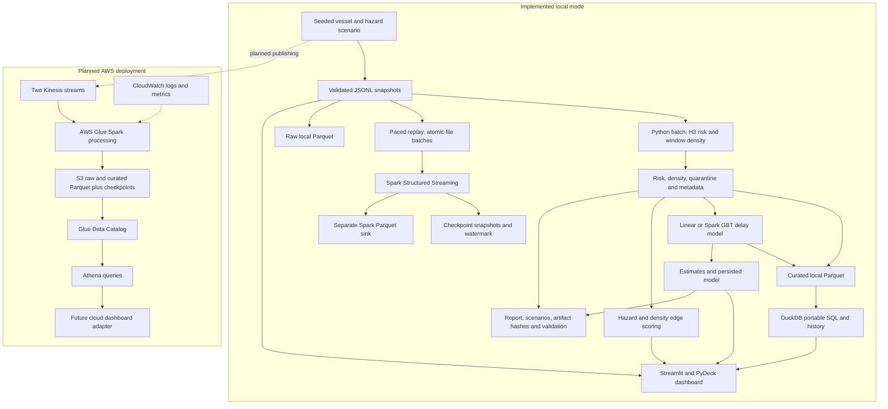

# Architecture

The same packaged JSON contracts connect generation, processing, storage, and
presentation. Local mode is implemented and tested; the cloud path is planned
and has not been deployed.

Local lake datasets are partitioned by each row's UTC event date; raw contains
telemetry/alerts, curated contains risk/density/delay estimates. Explicit Arrow
schemas preserve types. SQL and JSON Schemas ship as package resources.
Configuration precedence is flags, shell, dotenv, defaults. The dashboard
loads configured JSONL outputs and lake history; Spark's separate sink is not
connected to the current dashboard loader. The report records settings,
acceptance results, and hashes. Quarantine and wall-clock metadata are excluded
from the reproducible artifact manifest.

The processing and storage module READMEs specify checkpoint recovery,
partition replacement, revision behavior, and model artifacts. See
[limitations](limitations.md) before interpreting the diagram as production
architecture.
